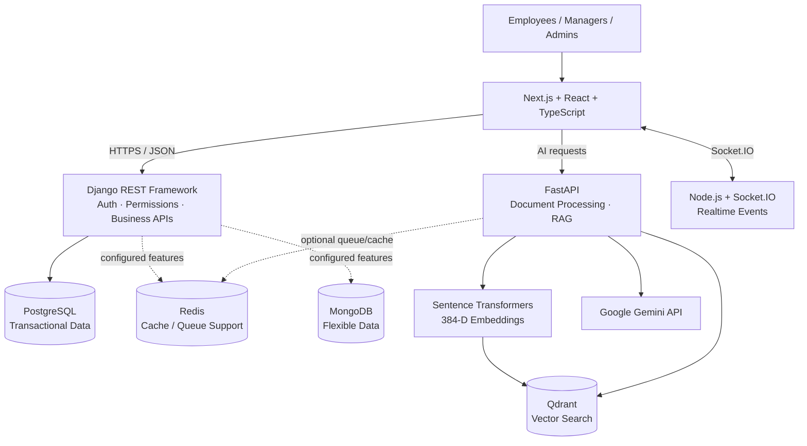
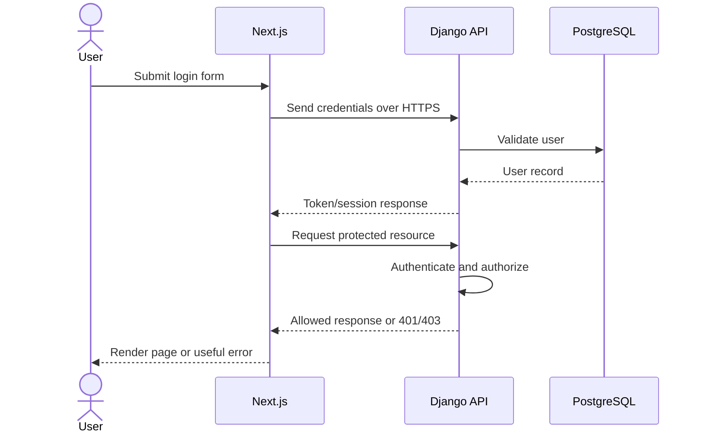
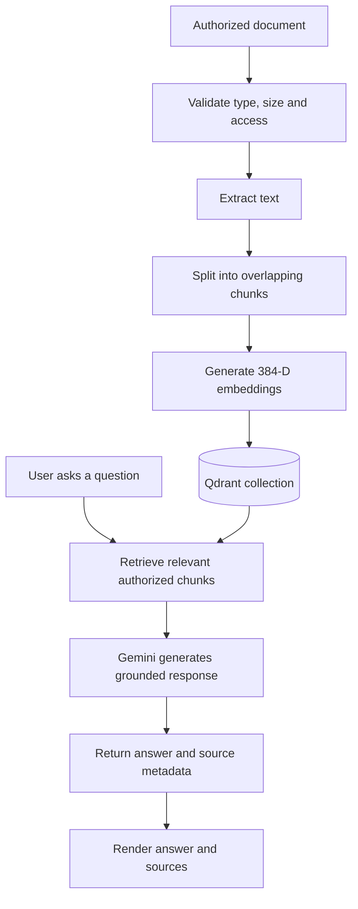

<div align="center">

# NEXORA

### AI-Powered Enterprise Operations & Intelligence Platform

**A modular enterprise platform combining business operations, role-based administration, realtime collaboration, and AI-powered document intelligence in one modern workspace.**

<br />


<br /><br />


<br /><br />

[Overview](#-overview) ·
[Architecture](#-architecture) ·
[Quick start](#-quick-start) ·
[Admin console](#-admin-console) ·
[Workspace](#-main-workspace) ·
[AI/RAG](#-ai--rag-pipeline) ·
[API reference](#-service-endpoints) ·
[Testing](#-testing--verification) ·
[Roadmap](#-implementation-roadmap) ·
[Troubleshooting](#-troubleshooting)

</div>

---

## 📌 Overview

NEXORA is a modular enterprise platform foundation designed to bring company operations, team collaboration, documents, and AI-powered knowledge retrieval into one secure workspace.

It separates responsibilities across a Next.js web application, a Django REST Framework core API, a FastAPI AI service, a Node.js + Socket.IO realtime service, and dedicated infrastructure services.

> **Implementation truth:** This README describes the known project foundation and the intended product direction. A feature listed as planned is not necessarily implemented. Inspect the repository and verify each endpoint, screen, dependency, and test before treating it as complete.

| Area                      | Current foundation / intended direction                            |
| ------------------------- | ------------------------------------------------------------------ |
| Product                   | NEXORA — AI-Powered Enterprise Operations & Intelligence Platform  |
| Frontend                  | Next.js, React, TypeScript                                         |
| Core API                  | Django + Django REST Framework                                     |
| AI service                | FastAPI, Sentence Transformers, Qdrant, Gemini                     |
| Structured data           | PostgreSQL                                                         |
| Additional infrastructure | Redis, MongoDB, Docker Compose                                     |
| Realtime                  | Node.js + Socket.IO skeleton                                       |
| Authentication            | Email-based user model, UUID IDs, JWT foundation                   |
| Roles                     | `EMPLOYEE`, `MANAGER`, `ADMIN`                                     |
| UI direction              | Responsive enterprise SaaS, dark/light themes, reusable components |
| Local development         | Windows + VS Code + PowerShell                                     |

## ✨ Product goals

- Secure login, logout, token refresh, and role-based access.
- A dedicated **Admin Console** for user and organization administration.
- A **Main Workspace** for employees and managers.
- Employee and department management.
- Projects, tasks, customers, and support tickets.
- Document upload, extraction, indexing, and semantic search.
- RAG answers grounded in retrieved document context.
- Realtime collaboration and notifications.
- Data-backed analytics and audit trails.
- Responsive UI, accessible interactions, and light/dark themes.
- Automated checks, deployment documentation, and operational monitoring.

## 🧰 Technology stack

| Technology                                                                                                          | Role in NEXORA                                                       |
| ------------------------------------------------------------------------------------------------------------------- | -------------------------------------------------------------------- |
|  **Next.js**             | Web app, App Router, layouts, and frontend routing                   |
|  **React**                  | Interactive UI and reusable components                               |
|  **TypeScript**           | Typed frontend code and API contracts                                |
|  **Tailwind CSS** | Responsive styling and design tokens                                 |
| **shadcn/ui**                                                                                                       | Accessible UI building blocks, if compatible with the existing setup |
| **Lucide React**                                                                                                    | Consistent interface icons                                           |
| **Recharts**                                                                                                        | Data visualizations where useful                                     |
|  **Python**               | Django and FastAPI services                                          |
|  **Django + DRF**         | Core business APIs, authentication, permissions, admin               |
|  **FastAPI**            | AI and document intelligence endpoints                               |
|  **PostgreSQL**     | Transactional business records                                       |
|  **MongoDB**            | Flexible/semi-structured data when required                          |
|  **Redis**                  | Caching, queues, or realtime support where configured                |
| **Qdrant**                                                                                                          | Vector storage and semantic retrieval for RAG                        |
| **Sentence Transformers**                                                                                           | Text embeddings using `all-MiniLM-L6-v2`                             |
| **Google Gemini API**                                                                                               | Language-model responses grounded in retrieved context               |
|  **Node.js + Socket.IO** | Realtime communication service                                       |
|  **Docker Compose**       | Local infrastructure orchestration                                   |
| **Prometheus**                                                                                                      | Monitoring, if configured in the repository                          |

**Dependency rule:** Before adding or upgrading packages, inspect the existing package manifests and Python requirements. Keep the versions that currently work unless a specific issue justifies a change.

---

## 🏛️ Architecture

### High-level system architecture



### Service boundaries

| Service               | Owns                                                        | Should not become                                      |
| --------------------- | ----------------------------------------------------------- | ------------------------------------------------------ |
| Next.js frontend      | Pages, forms, presentation, client interactions             | The authority for permissions or business rules        |
| Django REST Framework | Core users, business rules, permissions, transactional APIs | A duplicate AI pipeline                                |
| FastAPI               | Document processing, embeddings, retrieval, AI responses    | A bypass around business authorization                 |
| Realtime service      | Authenticated event delivery                                | A channel that broadcasts private data to everyone     |
| PostgreSQL            | Authoritative structured business records                   | A cache for unvalidated frontend state                 |
| Qdrant                | Searchable vector representations and metadata              | The only source of truth for original business records |
| Redis                 | Configured cache/queue/realtime support                     | A replacement for durable transactional storage        |
| MongoDB               | Flexible records for clearly defined use cases              | An unnecessary duplicate of every PostgreSQL table     |

### Typical authenticated request

1. The user signs in through the frontend.
2. Django validates the credentials and issues tokens according to the configured authentication flow.
3. The frontend calls protected APIs.
4. Django checks authentication, role, and object-level permissions where applicable.
5. Authorized business data is read or updated in PostgreSQL.
6. AI requests go through the AI service boundary with authorization context handled safely.
7. The frontend displays results, loading states, errors, and relevant source references.
8. Realtime events are emitted only to authenticated and authorized recipients.

> **Security principle:** Hiding a button in React is not authorization. Enforce every protected action on the server, including document access, role changes, and realtime subscriptions.

---

## 🗂️ Repository structure

The expected high-level layout is:

```text
NEXORA/
├── frontend/                       # Next.js application
│   ├── app/                        # App Router pages/layouts, if used
│   ├── components/                 # Shared UI components, if used
│   ├── lib/                        # API clients and helpers, if used
│   └── package.json
├── backend/
│   ├── django/                     # Core business API and authentication
│   │   ├── manage.py
│   │   ├── requirements.txt
│   │   └── ...                     # Apps, settings, migrations, URLs
│   └── fastapi/                    # AI and RAG service
│       ├── app/
│       │   ├── main.py
│       │   ├── routes/
│       │   └── ...                 # Services and schemas
│       ├── requirements.txt
│       └── .env                    # Local secret file; never commit
├── services/
│   └── realtime/                   # Node.js + Socket.IO
├── infrastructure/                 # Docker/monitoring configuration
├── scripts/                         # Setup helpers
├── tests/                           # Tests and integration checks
├── docs/                            # Architecture/security documentation
├── docker-compose.yml               # Confirm actual filename
├── .env.example                     # Placeholder configuration only
└── README.md
```

This is a guide, not a claim that every directory above already exists. **Inspect the real repository before creating, moving, or renaming files.**

---

## 🚀 Quick start

### Prerequisites

- Windows 10/11
- VS Code
- Git
- Docker Desktop with Docker Compose
- A Python version compatible with the installed project dependencies
- A Node.js version compatible with the frontend and realtime packages
- A Google Gemini API key for live Gemini-powered responses

Use the Python version already supported by the project. The commands below use Python 3.12 as an example because that is the version specified in the current setup notes; verify availability before creating a new environment.

### 1. Open the project

Open the existing folder in VS Code:

```powershell
cd D:\NEXORA
code .
```

Check Git status before editing:

```powershell
git status --short
```

Keep existing uncommitted work safe. Do not reset or discard changes simply to make the working tree clean.

### 2. Review configuration files

Inspect these files if present:

- `docker-compose.yml`
- `.env.example`
- `backend/django/requirements.txt`
- `backend/fastapi/requirements.txt`
- `frontend/package.json`
- `services/realtime/package.json`
- Setup scripts under `scripts/`

Create local environment files according to the repository's actual settings. Never paste secrets into README files, Git commits, screenshots, or chat.

### 3. Bootstrap helper (optional)

If the repository contains the documented bootstrap script, inspect it first and then run:

```powershell
.\scripts\bootstrap.ps1
```

If PowerShell says the script does not exist, do not create a guessed replacement. Inspect `scripts/` and follow the actual setup instructions.

### 4. Start infrastructure

From the repository root, if the Compose file defines these services:

```powershell
docker compose up -d postgres redis mongodb
docker compose ps
```

Check service names against the Compose file. Qdrant may be configured separately; start it using the actual service definition if the AI service requires it.

### 5. Set up Django

Open a terminal at the repository root:

```powershell
py -3.12 -m venv .venv
.\.venv\Scripts\Activate.ps1
python -m pip install -r backend/django/requirements.txt
python backend/django/manage.py check
python backend/django/manage.py migrate
```

Create a new development administrator only if required:

```powershell
python backend/django/manage.py createsuperuser
```

Start Django:

```powershell
python backend/django/manage.py runserver
```

Expected local address: `http://127.0.0.1:8000`

If a compatible `.venv` already exists, activate and reuse it rather than creating another environment unnecessarily.

### 6. Start FastAPI

Open a **second terminal** at the repository root. Activate the same compatible Python environment if the two requirements files are intentionally designed to share it:

```powershell
.\.venv\Scripts\Activate.ps1
python -m pip install -r backend/fastapi/requirements.txt
uvicorn app.main:app --app-dir backend/fastapi --reload --port 8001
```

Expected local documentation: `http://127.0.0.1:8001/docs`

If installing the two requirements files causes dependency conflicts, stop and use the repository's intended separate environments. Do not blindly downgrade packages.

### 7. Start the realtime service

Open a **third terminal**:

```powershell
cd D:\NEXORA\services\realtime
npm install
npm run dev
```

Expected health address from the current setup notes: `http://127.0.0.1:3001/health`

Verify the port and script in `services/realtime/package.json` and its configuration.

### 8. Start the frontend

Open a **fourth terminal**:

```powershell
cd D:\NEXORA\frontend
npm install
npm run dev
```

Expected frontend address: `http://localhost:3000`

Verify the frontend's environment variables point to the correct local API services.

### Local service URLs

| Service          | Local URL                    | Purpose                                |
| ---------------- | ---------------------------- | -------------------------------------- |
| Next.js frontend | http://localhost:3000        | Main web application                   |
| Django API       | http://127.0.0.1:8000        | Core business API                      |
| Django Admin     | http://127.0.0.1:8000/admin/ | Trusted administrative interface       |
| FastAPI docs     | http://127.0.0.1:8001/docs   | AI service OpenAPI documentation       |
| Realtime health  | http://127.0.0.1:3001/health | Realtime service health, if configured |

These are development addresses. Actual routes, ports, and environment settings must be confirmed in the source.

---

## 🔐 Environment configuration and secrets

`.env.example` must contain placeholders only. Copy the relevant example into the local environment file required by each service.

Configuration may include:

| Variable category         | Purpose                                     |
| ------------------------- | ------------------------------------------- |
| Django secret key         | Signs Django security-related values        |
| Debug and allowed hosts   | Controls development and host validation    |
| Database URL/credentials  | PostgreSQL connection                       |
| JWT configuration         | Token lifetimes and authentication settings |
| CORS / trusted origins    | Permitted frontend origins                  |
| Gemini API key            | Authenticates AI provider requests          |
| Gemini model name         | Selects a supported model                   |
| Qdrant URL and collection | Vector database connection and collection   |
| Redis URL                 | Cache, queue, or realtime support           |
| MongoDB URI               | Flexible-data connection                    |
| Frontend public API URL   | Browser-accessible backend base URL         |
| Realtime URL              | Socket.IO server address                    |

Use the exact variable names expected by the code. Do not assume every variable in this table already exists.

### Security checklist

- [ ] `.env` and secret files are excluded from Git.
- [ ] `.env.example` contains no real secrets.
- [ ] Development and production credentials are different.
- [ ] CORS and allowed hosts are restricted appropriately.
- [ ] Authentication and permissions are enforced server-side.
- [ ] Refresh-token invalidation is tested.
- [ ] Administrative actions are logged where appropriate.
- [ ] Document retrieval respects the user's permissions.
- [ ] Uploaded files have size/type validation and safe storage.
- [ ] Production uses HTTPS and secure cookie settings where applicable.
- [ ] Logs do not expose passwords, bearer tokens, or secret values.

Do not reuse development passwords in production.

---

## 🛡️ Authentication and roles

The current foundation includes:

- Custom email-based Django user model.
- UUID user IDs.
- `EMPLOYEE`, `MANAGER`, and `ADMIN` roles.
- JWT login and refresh.
- Refresh-token blacklist.
- Current-user endpoint.
- Role-based permission foundation.
- Admin-only endpoint.
- Manager-or-admin endpoint.
- Public registration foundation.
- Django Admin.

### Intended role responsibilities

| Role       | Intended access                                                                 |
| ---------- | ------------------------------------------------------------------------------- |
| `EMPLOYEE` | Own profile, assigned work, permitted project information, authorized documents |
| `MANAGER`  | Employee capabilities plus explicitly authorized team/department operations     |
| `ADMIN`    | Organization-wide administration according to server policy                     |

These are product intentions. Confirm the actual permission classes and object-level access rules in Django before assuming a specific role can perform an operation.

### Authentication flow



Use the token-storage and refresh approach already implemented unless a security review identifies a concrete issue. Do not store long-lived secrets in browser local storage without evaluating the risks.

---

## 🖥️ Admin Console

The Admin Console should provide a polished, data-backed view of the organization and system.

### Admin overview

Potential panels:

- Total users and active users.
- Department and project summaries.
- Task completion and overdue task counts.
- Recent administrative events.
- AI document indexing status.
- Backend/realtime health.
- Relevant trends and charts.

Only show metrics supported by real API data. Do not present mock counts as live organizational statistics.

### User management

- Search by name or email.
- Filter by role and status.
- Paginated table.
- User detail view.
- Create/edit workflows supported by the API.
- Controlled role changes.
- Account activation/deactivation when supported.
- Confirmation for sensitive changes.
- Clear success, validation, and permission errors.

### Department management

- Department listing and detail views.
- Manager assignment.
- Employee counts.
- Create/update/archive operations according to the business rules.

### Organization-wide operations

- Project and task visibility according to admin permissions.
- Customer and support oversight where implemented.
- Audit log search and filtering.
- Service health information.
- AI indexing and document processing status.

### Admin UI references

The images below are **design inspiration**, not screenshots of the current NEXORA application.

<p align="center">
  
</p>

For implementation, use actual React components and real API responses. Replace conceptual placeholders with screenshots of the working product after the screens exist.

---

## 👥 Main Workspace

The main workspace is the everyday interface for employees and managers.

### Dashboard

- Personalized greeting and profile.
- Assigned tasks and upcoming deadlines.
- Project progress.
- Recent activity.
- Notifications.
- Quick actions.
- Data filtered by the authenticated user's permissions.

### Employee workspace

- View assigned projects and tasks.
- Update task status when authorized.
- Access permitted documents.
- Ask questions about indexed knowledge.
- View relevant notifications.
- Update allowed profile fields.

### Manager workspace

- View authorized team information.
- Review project progress and workload.
- Manage assignments where permitted.
- Review overdue tasks.
- Access allowed department information.

### Main UI design references

<p align="center">
  
</p>

### UI quality requirements

- Responsive sidebar and top navigation.
- Light and dark theme.
- Accessible colors and keyboard focus.
- Consistent typography, spacing, borders, and card styles.
- Search, filters, pagination, and form validation.
- Loading skeletons and useful empty states.
- Clear error messages and toast notifications.
- Confirmation dialogs for destructive actions.
- Functional links and buttons.
- Charts based on real data.
- No fake success messages or dead controls.

### Suggested UI libraries

Adopt only what is needed and compatible with the installed frontend:

- **Tailwind CSS** for styling.
- **shadcn/ui** for accessible component foundations.
- **Lucide React** for icons.
- **Recharts** for charts.
- **React Hook Form + Zod** for forms and schema validation where appropriate.
- A consistent theme provider for dark/light mode.

Technology logos belong in documentation and architecture sections. Operational pages should use consistent product icons and design patterns rather than a collage of stack logos.

---

## 📚 Enterprise modules

Implement modules in dependency order. Some are existing foundations; others are planned work.

| Module        | Intended functionality                        | Verification needed                   |
| ------------- | --------------------------------------------- | ------------------------------------- |
| Accounts      | Login, refresh, logout, current user          | Tokens and permissions work           |
| Employees     | User profiles and employee directory          | API, validation, access scope         |
| Departments   | Organization structure and manager assignment | Data integrity and permissions        |
| Projects      | Project creation, membership and status       | Model/API/UI integration              |
| Tasks         | Assignment, status, due dates and priority    | Business rules and transitions        |
| Customers     | Customer records and ownership                | Authorized CRUD operations            |
| Support       | Tickets, status, priority and assignment      | Workflow and access control           |
| Documents     | Upload, extraction, indexing status           | File validation and storage           |
| AI/RAG        | Semantic retrieval and grounded answers       | Sources, relevance and access control |
| Realtime      | Authenticated event delivery                  | Private room and event authorization  |
| Notifications | In-app notifications and read state           | Persistence and delivery              |
| Analytics     | Aggregated operational metrics                | Correct queries and definitions       |
| Audit logs    | Record sensitive actions                      | Integrity and useful filtering        |
| Workflows     | Configurable operational automation           | Validation and execution safety       |
| Monitoring    | Health, metrics and useful logs               | Accurate operational signals          |
| CI/CD         | Repeatable checks and deployment              | Reproducible build and release        |

---

## 🤖 AI & RAG pipeline

NEXORA's AI service is intended to answer questions using authorized organizational documents.

### Current AI foundation

The project context records:

- FastAPI service and health/status endpoints.
- Document extraction endpoint.
- Text chunking with a default chunk size of 1,000 characters and overlap of 150 characters.
- Sentence Transformers model: `sentence-transformers/all-MiniLM-L6-v2`.
- Embedding dimension: 384.
- Qdrant collection: `nexora_documents`.
- Google Gemini integration.
- Document indexing and RAG route/service foundations.

Confirm current defaults in the code. Chunking settings may be configurable.

### RAG flow



### Expected AI workflow

1. An authorized user submits a supported document.
2. The service validates file type, size, and access permissions.
3. Text is extracted.
4. The processor creates overlapping chunks.
5. Sentence Transformers creates embeddings.
6. Qdrant stores vectors and document metadata.
7. A user asks a question.
8. Retrieval finds relevant chunks within the user's authorized scope.
9. Gemini receives the question and retrieved context.
10. The response includes source metadata where available.
11. The UI shows the answer, sources, loading state, and any errors.

### RAG quality and security

- Restrict retrieval to documents the user is allowed to access.
- Treat document text as untrusted input.
- Do not allow retrieved instructions to override system rules.
- Return an honest insufficient-evidence response when appropriate.
- Include source references only when backed by retrieval metadata.
- Handle missing API keys, provider timeouts, quotas, and service failures.
- Avoid logging sensitive document contents unnecessarily.
- Prevent duplicate indexing where practical.
- Track indexing state and provide recovery from failures.
- Evaluate retrieval quality and groundedness using representative test questions.

**Known development issue from earlier work:** A Gemini request previously returned an invalid API-key error even though a variable existed in the environment file. If this recurs, verify the variable name expected by the code, the environment loaded by the running process, key validity, provider project/API access, and restart the process after changing configuration. Never print the actual key in logs or chat.

---

## 🔌 Service endpoints

The following are **known local service addresses**, not a complete endpoint contract.

| Service         | Address                        | Purpose                          |
| --------------- | ------------------------------ | -------------------------------- |
| Django          | `http://127.0.0.1:8000`        | Core API                         |
| Django Admin    | `http://127.0.0.1:8000/admin/` | Administrative interface         |
| FastAPI docs    | `http://127.0.0.1:8001/docs`   | Interactive AI API documentation |
| Realtime health | `http://127.0.0.1:3001/health` | Realtime health if configured    |
| Frontend        | `http://localhost:3000`        | Web application                  |

### Endpoint documentation rules

- Use Django URL configuration and FastAPI route definitions as the source of truth.
- Document HTTP method, path, authentication, permissions, request schema, response schema, and common errors.
- Include examples with fake data only.
- Do not publish access tokens or real customer information.
- Keep OpenAPI documentation aligned with the implementation.

FastAPI's `/docs` page is the preferred way to inspect its current registered routes.

---

## 🧪 Testing & verification

Run checks in small steps and record the actual results.

### Django checks

```powershell
python backend/django/manage.py check
python backend/django/manage.py showmigrations
python backend/django/manage.py migrate --check
```

Run the project's test suite if configured:

```powershell
python backend/django/manage.py test
```

### FastAPI checks

With the correct environment activated:

```powershell
python -m compileall backend/fastapi/app
uvicorn app.main:app --app-dir backend/fastapi --port 8001
```

In a separate terminal, inspect `http://127.0.0.1:8001/docs` and run the project's actual tests if present.

### Frontend checks

From `frontend/`, inspect the scripts in `package.json`. Common scripts, only if defined, include:

```powershell
npm run lint
npm run build
```

### Realtime checks

From `services/realtime/`, inspect the scripts in `package.json` and run the relevant tests and health checks.

### Integration verification

- [ ] PostgreSQL is reachable.
- [ ] Redis/MongoDB are reachable where required.
- [ ] Django checks and migrations pass.
- [ ] Login, refresh, logout, and current-user flows work.
- [ ] Unauthorized and forbidden requests are rejected.
- [ ] FastAPI health and document extraction work.
- [ ] Embedding dimension matches the Qdrant collection.
- [ ] Retrieval returns relevant authorized context.
- [ ] Gemini errors are handled safely.
- [ ] Frontend API URLs are correct.
- [ ] Realtime events require valid authorization.
- [ ] Frontend lint/build checks pass.
- [ ] Mobile and desktop layouts are usable.
- [ ] No secrets are tracked by Git.

A command being available is not proof that the project passes it. Record real outputs and fix failures before declaring the feature complete.

---

## 🛣️ Implementation roadmap

### Phase 1 — Audit and stabilize

- Inspect Git status and preserve current changes.
- Review the README, manifests, environment examples, and setup scripts.
- Inspect Django models, serializers, views, permissions, and routes.
- Inspect FastAPI routes, services, schemas, and settings.
- Inspect frontend layouts, routes, API client, and authentication state.
- Inspect realtime service and Docker Compose.
- Run existing checks and record verified functionality.

### Phase 2 — UI foundation

- Define typography, colors, spacing, borders, and theme tokens.
- Standardize the app shell, sidebar, top bar, and page headings.
- Build reusable tables, cards, forms, dialogs, filters, and status components.
- Implement responsive layouts and dark/light mode.
- Add meaningful loading, empty, error, and success states.

### Phase 3 — Authentication and authorization

- Verify login, logout, and refresh behavior.
- Verify role-aware navigation and protected routes.
- Test backend permissions for each role.
- Review object-level and document-level access.
- Ensure token and session handling is safe.

### Phase 4 — Admin Console

- Organization overview.
- User management.
- Department management.
- Project/task oversight.
- Audit logs.
- Service health and AI indexing status.

### Phase 5 — Main Workspace

- Personal dashboard.
- Projects and tasks.
- Customers and support tickets.
- Documents.
- Activity feed and notifications.

### Phase 6 — AI intelligence

- Document upload and extraction.
- Indexing state and recovery.
- Semantic search.
- Grounded answers with source metadata.
- Access-controlled retrieval.
- Error handling and evaluation.

### Phase 7 — Realtime and analytics

- Authenticated Socket.IO connections.
- Private rooms and authorized events.
- Notifications and activity updates.
- Data-backed analytics.
- Auditable administrative changes.

### Phase 8 — Production readiness

- Automated tests.
- Security and dependency review.
- Docker configuration review.
- Logging, metrics, and monitoring.
- CI/CD and deployment documentation.
- Backup, restore, and recovery planning.

---

## 🧭 Step-by-step working instructions for VS Code

Use this workflow whenever you continue development with a coding assistant.

### Step 1: Inspect before editing

Start at the project root:

```powershell
cd D:\NEXORA
git status --short
```

Inspect the relevant files and current setup before making changes.

### Step 2: Describe the feature and its boundaries

Identify:

- User story and expected behavior.
- Which roles may access the feature.
- Which API and data models are involved.
- Which frontend pages and components are involved.
- What existing behavior must not break.

### Step 3: Make one focused change

- Avoid rewriting unrelated files.
- Reuse existing components and services.
- Do not invent API paths or database fields.
- Do not upgrade packages without a reason.
- Preserve local user changes.

### Step 4: Verify the change

Run the relevant backend, frontend, or integration check. Capture the real result and fix errors before continuing.

### Step 5: Update documentation

Update API contracts, setup steps, architecture notes, or environment examples when behavior changes.

### Step 6: Report progress

For every development step, record:

1. **Goal**
2. **Files inspected**
3. **Files changed**
4. **Commands run**
5. **Expected result**
6. **Actual result**
7. **Known issues**
8. **Next step**

### Copy-and-use coding assistant prompt

> You are helping me develop NEXORA, an existing AI-powered enterprise platform in `D:\NEXORA`. First inspect the repository, Git status, README, dependency manifests, environment examples, and the files related to my requested change. Preserve working features and all existing uncommitted changes. Do not guess endpoint paths, models, settings, or package versions. Explain your plan before editing, make one focused change at a time, run relevant checks, report actual results, and give beginner-friendly PowerShell commands. Never expose or commit secrets. Stop and explain an error before proceeding to unrelated work.

---

## 🧯 Troubleshooting

### Docker services are not running

```powershell
docker compose ps
docker compose logs --tail 100 postgres
```

Use the actual service name in the Compose file. Check Docker Desktop and service health before restarting or deleting volumes.

### Django cannot connect to PostgreSQL

- Verify the PostgreSQL container is running.
- Confirm database host, port, database name, username, and password in the local configuration.
- Remember that `localhost` inside a container means that container itself, not another Compose service.
- Run Django's system check and inspect the error without printing secret values.

### FastAPI imports fail

- Run commands from the expected project directory.
- Activate the correct Python environment.
- Confirm `backend/fastapi/requirements.txt` was installed.
- Verify `app/main.py` exists and matches the configured `--app-dir`.
- Check for dependency conflicts before reinstalling packages.

### Gemini API returns an invalid-key error

- Confirm the variable name expected by the code.
- Confirm the intended `.env` file is loaded by the FastAPI process.
- Verify the key is valid and the provider API is enabled.
- Restart the process after environment changes.
- Do not paste the key into the terminal output you share.

### Qdrant dimension mismatch

- Confirm the embedding model returns vectors with 384 dimensions.
- Confirm the collection's configured vector size.
- Check the model and collection configuration before changing or recreating a collection.
- Preserve data and take a backup before destructive changes.

### Frontend cannot reach an API

- Verify the frontend environment variable and base URL.
- Confirm the backend service is running.
- Check CORS configuration.
- Inspect browser network errors and backend logs.
- Use the appropriate browser-accessible address; container-internal hostnames may not work in the browser.

### UI changes are not visible

- Confirm the changed file is actually imported.
- Check the relevant stylesheet and component hierarchy.
- Restart the development server only when necessary.
- Inspect browser console errors and build output.
- Confirm the page is using the expected theme and layout.

### A command or file in this README does not exist

Treat the repository as authoritative. Inspect the actual scripts, route configuration, manifests, and filenames; update the README rather than inventing missing files.

---

## 📦 Data, backups, and development accounts

A source-code archive does not automatically include local PostgreSQL data, Docker volumes, tokens, or real passwords.

- Create a fresh local administrator using Django's `createsuperuser` command when needed.
- Use test accounts with non-production credentials.
- Back up local data before destructive database or vector-collection operations.
- Keep local environment files out of shared archives.
- Never assume a previous development database or its users exist on a new machine.

---

## ✅ Definition of done

A feature is complete only when:

- The UI is responsive and consistent with the design system.
- Inputs are validated on the server.
- Authentication and authorization are enforced.
- Data persists and follows the defined business rules.
- Loading, empty, error, and success states are implemented.
- Tests or documented verification steps pass.
- Secrets are not committed or logged.
- Documentation matches the actual code.
- Existing functionality continues to work.
- The feature is clearly marked as implemented, partial, or planned.

## 🌟 Final vision

NEXORA aims to become a unified enterprise workspace where authorized users manage operations, collaborate in realtime, access business information, and retrieve organizational knowledge through AI.

The goal is not only a visually impressive dashboard. It is a secure, maintainable, testable platform with clear service boundaries, reliable data flows, useful AI responses, and a polished user experience.

<div align="center">

**NEXORA — Connect your operations. Empower your teams. Turn knowledge into action.**

</div>
